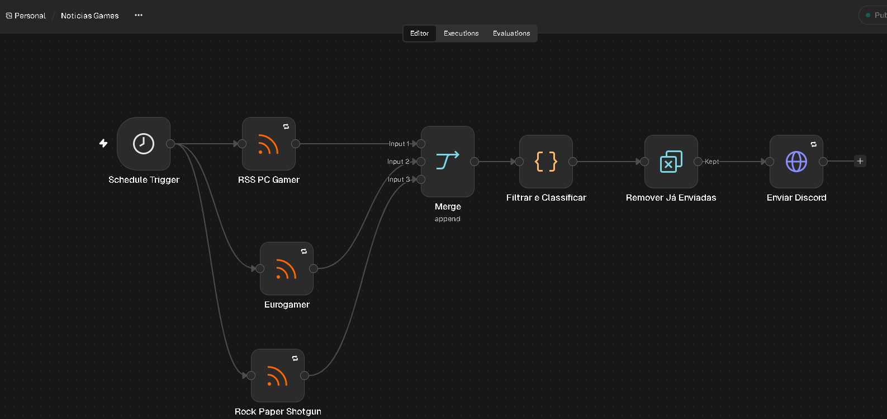
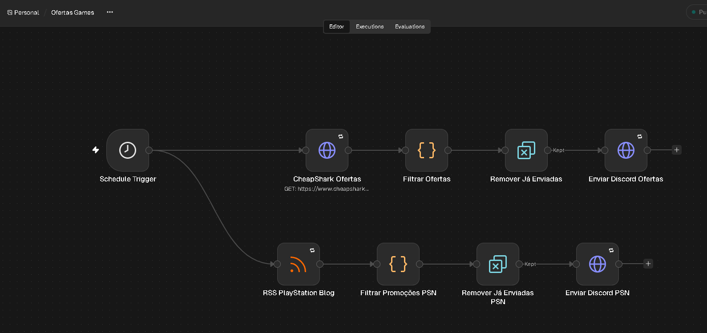
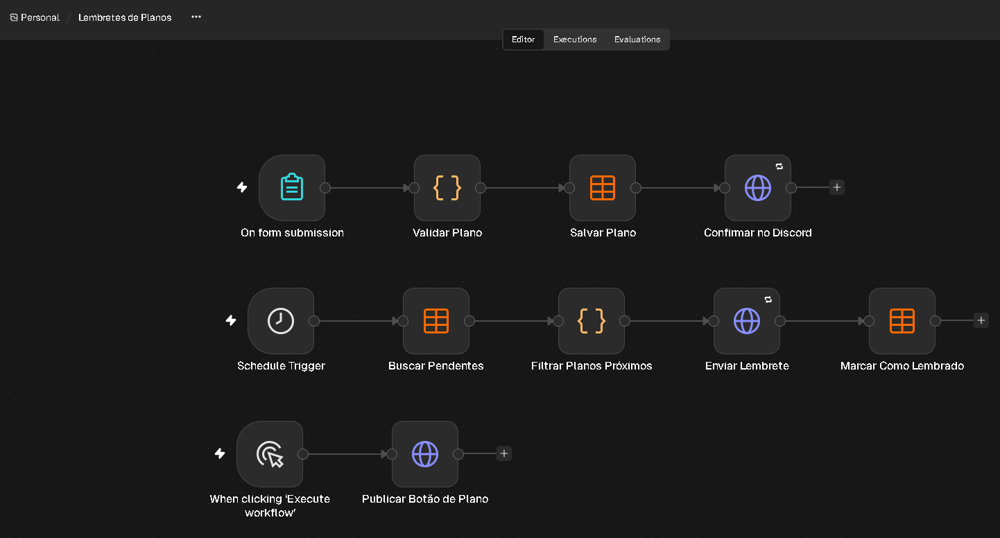
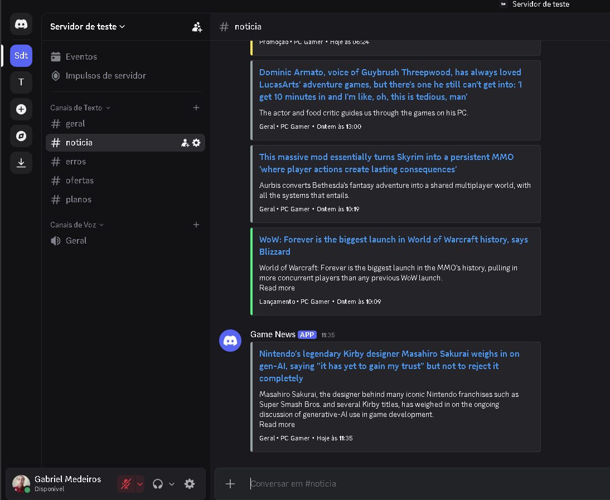
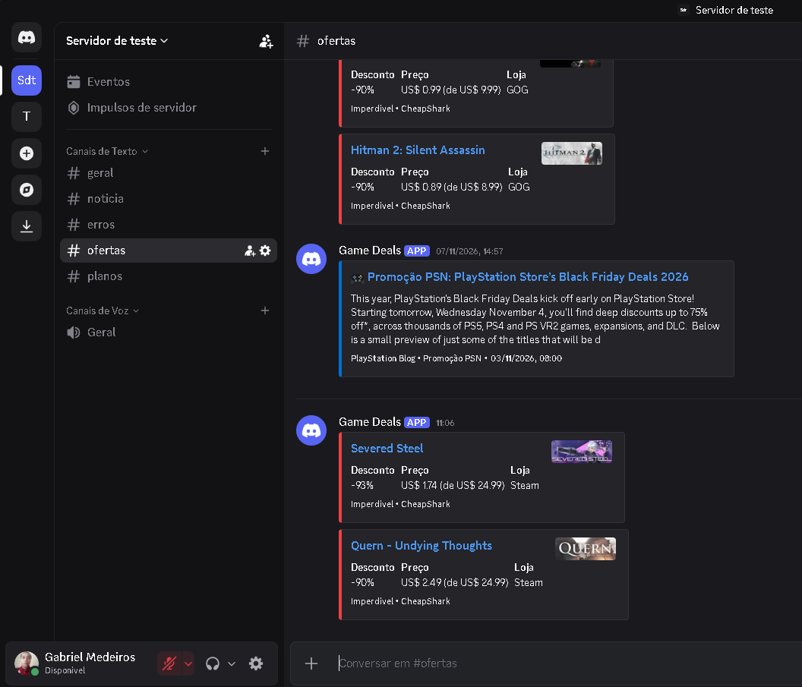
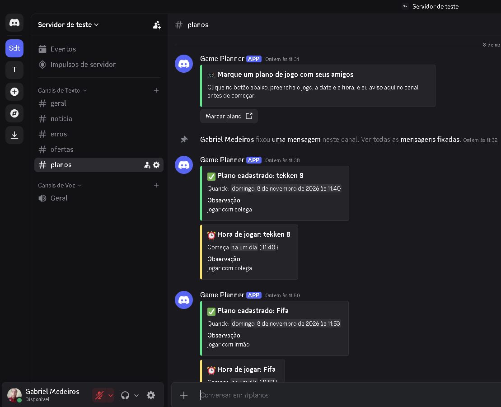
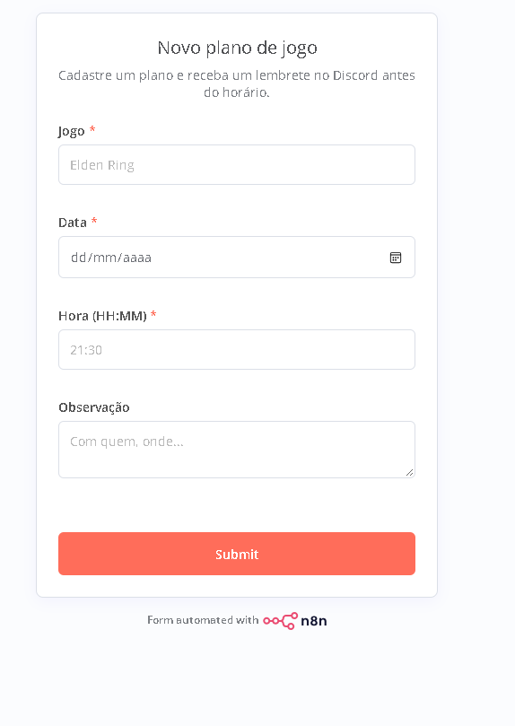
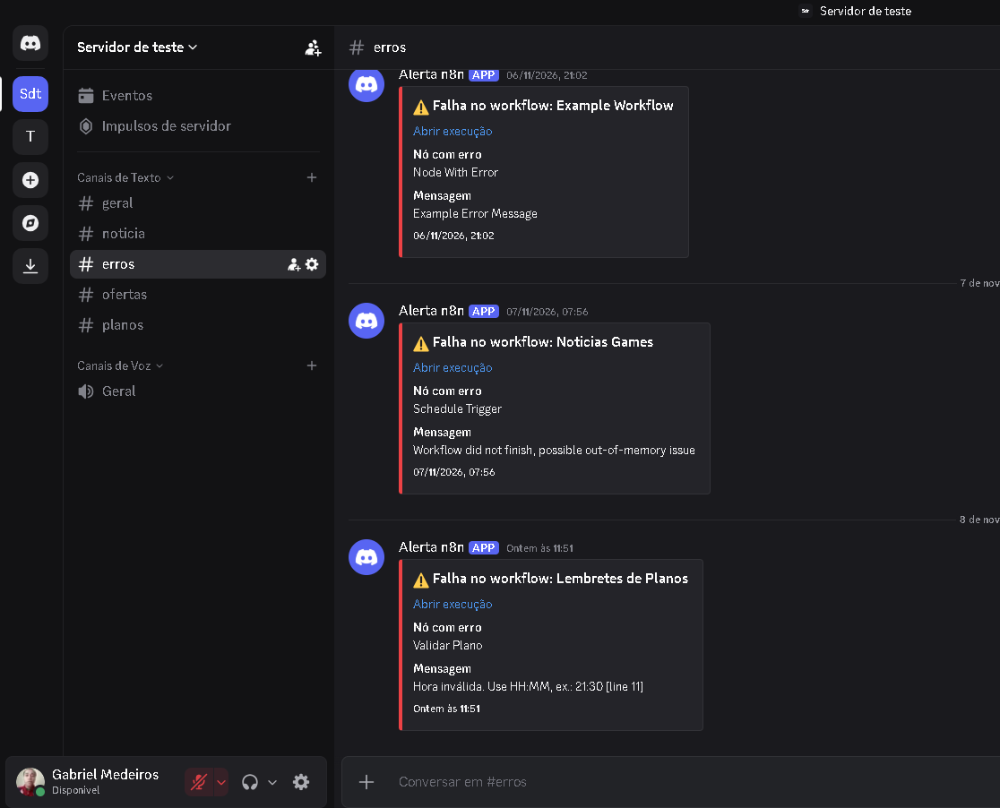
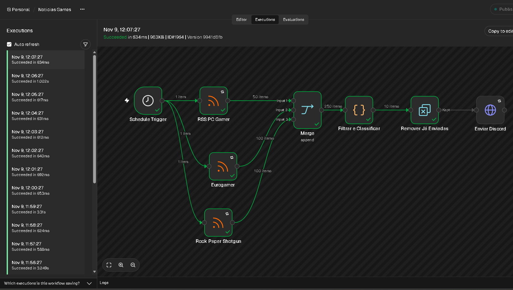

# 🎮 Game Hub Bot

Central de automações para quem joga, feita em **n8n** e entregue no **Discord**. Três workflows independentes, mais um de alertas de erro:

| Workflow | O que faz |
|---|---|
| **Noticias Games** | Lê feeds RSS de notícias de jogos, filtra, classifica e posta só o que interessa |
| **Ofertas Games** | Avisa descontos na Steam e na GOG (API CheapShark) e campanhas de promoção da PlayStation Store (PlayStation Blog) |
| **Lembretes de Planos** | Um botão no Discord abre um formulário; o plano cadastrado vira um lembrete automático antes do horário |
| **Alerta de Erros** | Se qualquer workflow falhar, avisa em um canal separado |

> Projeto final da disciplina **Automação e Programabilidade em Redes** (UniSenac Pelotas), desenvolvido por **Gabriel Medeiros** e **Vinicius Dobke**.

---

## 1. Sobre o Projeto e Problema Resolvido

Quem joga precisa acompanhar muita coisa ao mesmo tempo: notícias espalhadas em vários sites, promoções que duram poucos dias e combinados com amigos que se perdem no chat. Na prática, isso significa abrir várias abas, perder ofertas e esquecer horários.

Este projeto leva tudo para o Discord, onde o grupo já está:

- **Notícias** filtradas por franquias e plataformas de interesse, classificadas por categoria (Review, Promoção, Lançamento, Indústria, Geral);
- **Ofertas** só dos jogos com desconto relevante e boa avaliação, sem repetir o que já foi avisado;
- **Planos de jogo** marcados em um clique e lembrados automaticamente, sem ninguém precisar cobrar no chat;
- **Alertas** quando algo quebra, em vez de falhas silenciosas.

**Ganho prático:** zero tempo garimpando notícias e promoções, e nenhum horário esquecido.

## 2. Arquitetura e Fluxo de Funcionamento

```mermaid
flowchart TB
    subgraph NEWS["1. Noticias Games - a cada 30 min"]
        direction LR
        N1["Schedule"] --> N2["RSS PC Gamer"] --> N3["Code: filtro e categoria"] --> N4["Remove Duplicates"] --> N5["Discord #noticias"]
    end
    subgraph DEALS["2. Ofertas Games - a cada 6 h"]
        direction LR
        D0["Schedule"] --> D1["API CheapShark<br/>Steam e GOG"] --> D2["Code: desconto e qualidade"] --> D3["Remove Duplicates"] --> D4["Discord #ofertas"]
        D0 --> P1["RSS PlayStation Blog"] --> P2["Code: filtro de promocoes"] --> P3["Remove Duplicates"] --> D4
    end
    subgraph PLANS["3. Lembretes de Planos"]
        direction LR
        L1["Botao no Discord"] --> L2["Formulario n8n"] --> L3["Code: validacao"] --> L4[("Data table")] --> L5["Discord #planos: confirmacao"]
        L6["Schedule"] --> L7["Buscar pendentes"] --> L8["Code: janela de 30 min"] --> L9["Discord #planos: lembrete"] --> L10["Marcar como lembrado"]
    end
    ERR["Error Trigger"] --> ERR2["Discord #alertas-bot"]
```



**Caminho dos dados (Gatilho → Processamento → Saída):**

1. **Noticias Games:** o *Schedule* dispara a leitura do feed RSS (XML). O nó *Code* valida cada item, filtra por palavras-chave, classifica a categoria, ordena por data e limita a quantidade. O *Remove Duplicates* descarta links já enviados. O *HTTP Request* publica um embed colorido no Discord.
2. **Ofertas Games:** o *Schedule* aciona dois ramos em paralelo. No ramo de PC, a API CheapShark (JSON) devolve ofertas da Steam e da GOG; o *Code* filtra por desconto mínimo e por nota (Metacritic ou avaliação dos jogadores), define a faixa da oferta e a deduplicação usa jogo + loja + preço, então uma queda de preço volta a ser avisada. No ramo da PSN, o feed do PlayStation Blog é filtrado por palavras de promoção no título e por idade do post.
3. **Lembretes de Planos:** um botão de link no Discord abre o formulário do n8n. O *Code* valida jogo, data e hora (fuso de Brasília) e o plano é gravado numa *Data table* com status `pendente`. Em outro ramo, um *Schedule* busca os pendentes, o *Code* seleciona os que começam em até 30 minutos, o Discord recebe o lembrete e só então a linha vira `lembrado`. Se o envio falhar, o plano continua pendente e a próxima rodada tenta de novo.
4. **Resiliência:** retry com espera nos nós de rede, timeout nos envios, `Stop Workflow` em caso de falha (para a falha ser visível) e um workflow separado com *Error Trigger* que avisa no canal de alertas.





### Como o projeto atende aos requisitos da disciplina

| Requisito | Onde aparece |
|---|---|
| Motor de automação | n8n self-hosted com nós Code em JavaScript |
| Múltiplas integrações | RSS (PC Gamer, PlayStation Blog), API REST CheapShark, Discord Webhooks, formulário e Data table do n8n |
| Transformação de dados | Parse de XML e JSON; validação, filtros, classificação, ordenação e montagem dos embeds |
| Autenticação e credenciais | Webhooks do Discord em variáveis de ambiente (`.env`), nunca nos fluxos exportados |
| Gatilho e saída concreta | Schedule e formulário como gatilhos; mensagens formatadas e registros na Data table como saída |
| Tratamento de erros | Retry, timeout, validação de campos e workflow de alerta com *Error Trigger* |

## 3. Tecnologias e APIs Utilizadas

- **n8n** (self-hosted) com nós Schedule, RSS Feed Read, HTTP Request, Code, Remove Duplicates, Form Trigger, Data table e Error Trigger
- **Docker / Docker Compose**
- **JavaScript** (nós Code)
- **RSS/XML:** PC Gamer e PlayStation Blog
- **API REST CheapShark** (gratuita, sem chave): ofertas de lojas de PC
- **Discord Webhooks** (HTTPS + JSON), incluindo embeds, timestamps dinâmicos e botão de link (`with_components=true`)

## 4. Pré-requisitos e Como Executar

**Pré-requisitos**

- [Docker Desktop](https://www.docker.com/products/docker-desktop/)
- Um servidor Discord com 4 canais (notícias, ofertas, planos e alertas) e **um webhook em cada** (*Configurações do canal → Integrações → Webhooks*)

**Passo a passo**

```bash
# 1. Clonar o repositório
git clone https://github.com/SEU_USUARIO/bot-noticias-games.git
cd bot-noticias-games

# 2. Criar o arquivo de variáveis a partir do exemplo
cp .env.example .env        # no Windows (PowerShell): Copy-Item .env.example .env
# edite o .env e cole as URLs dos seus webhooks

# 3. Subir o n8n
docker compose up -d
```

4. Acesse `http://localhost:5678` e crie a conta de administrador local.
5. **Crie a Data table:** no menu lateral, aba *Data tables → Create Data table*, com o nome `planos_jogos` e quatro colunas do tipo **string**: `jogo`, `quando`, `observacao`, `status`.
6. **Importe os workflows** (menu **⋯ → Import from file**), nesta ordem:
   1. `workflows/alerta-erros.json`
   2. `workflows/noticias-games.json`
   3. `workflows/ofertas-games.json`
   4. `workflows/lembretes-planos.json`
7. **Reselecione a Data table** `planos_jogos` nos três nós do workflow de planos: `Salvar Plano`, `Buscar Pendentes` e `Marcar Como Lembrado` (o n8n não leva a referência da tabela dentro do JSON).
8. Em cada um dos três workflows de automação, abra **⋯ → Settings → Error Workflow** e selecione `Alerta de Erros`.
9. **Ative** os três workflows (botão *Active* ou *Publish*, conforme a versão).
10. No nó `On form submission`, copie a **Production URL**, cole em `PLAN_FORM_URL` no `.env` e rode `docker compose up -d --force-recreate`.
11. Execute **uma única vez** o ramo `Publicar Botão de Plano` (clique em *Execute step* no nó) para criar a mensagem com o botão no canal de planos, e fixe a mensagem no Discord.

**Observações**

- Depois de editar o `.env`, recrie o container com `docker compose up -d --force-recreate`.
- Com o computador desligado, as automações não rodam. Ao voltar, elas continuam de onde pararam; só os itens novos são enviados.
- Os dados (workflows, conta, tabela e histórico de deduplicação) ficam no volume `n8n_data`. Não use `docker compose down -v`, que apaga esse volume.

### Segurança das credenciais

- As URLs dos webhooks ficam apenas no `.env`, listado no `.gitignore`;
- Os workflows exportados usam `{{ $env.NOME_DA_VARIAVEL }}`, nunca o valor real;
- O `.env.example` traz apenas valores de exemplo.

## 5. Demonstração (Resultados)

**Notícias filtradas e classificadas**



**Ofertas (Steam, GOG e campanha da PSN)**



**Botão para marcar plano, confirmação e lembrete**



**Formulário de cadastro**



**Alerta de falha no canal de erros**



**Histórico de execuções no n8n**



## 6. Limitações Conhecidas e Melhorias Futuras (Roadmap)

**Limitações atuais**

- O ramo da PSN avisa **campanhas** anunciadas pelo PlayStation Blog, não o preço de cada jogo, porque não há API oficial e gratuita de preços da PlayStation Store.
- Os preços da CheapShark vêm em dólar.
- O formulário roda em `localhost`; para os amigos usarem, o n8n precisa estar acessível na rede ou na internet.

**Roadmap**

1. **Deploy 24h:** rodar o mesmo `docker-compose.yml` numa VPS ou servidor de homelab, para as automações não dependerem do computador ligado e o botão funcionar para todos.
2. **Resumo com LLM e fontes em português:** gerar um resumo curto de cada notícia via API e adicionar feeds brasileiros.
3. **Planos mais completos:** registrar quem marcou o plano, enviar um segundo lembrete (por exemplo, 1 dia antes) e cobrar confirmação de presença.

---

## Estrutura do repositório

```
bot-noticias-games/
├── docker-compose.yml
├── .env.example
├── .gitignore
├── README.md
├── workflows/
│   ├── alerta-erros.json
│   ├── noticias-games.json
│   ├── ofertas-games.json
│   └── lembretes-planos.json
└── img/
    ├── fluxo-noticias.png
    ├── fluxo-ofertas.png
    ├── fluxo-planos.png
    ├── discord-noticias.png
    ├── discord-ofertas.png
    ├── discord-planos.png
    ├── formulario.png
    ├── discord-alerta.png
    └── n8n-execucoes.png
```